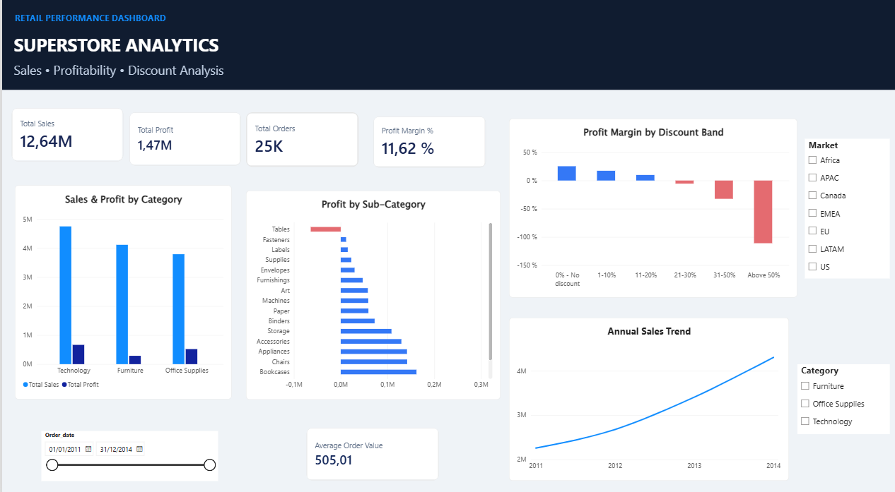
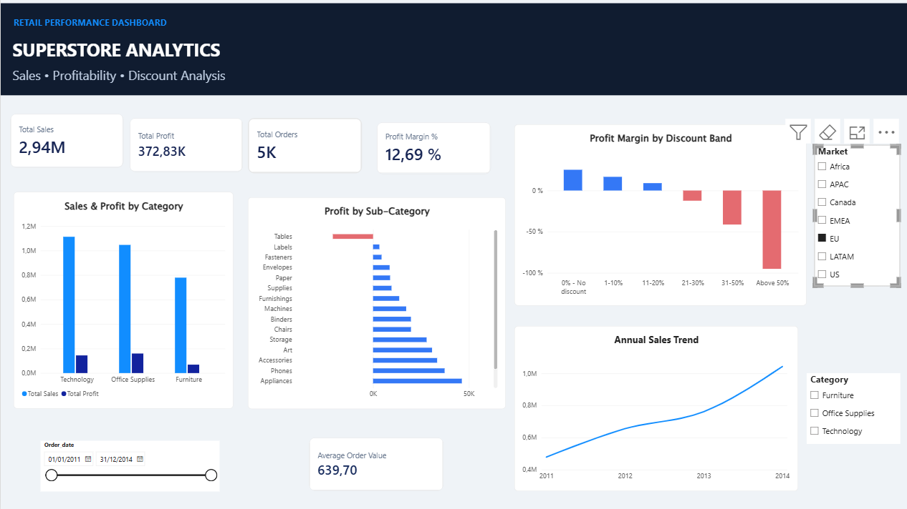
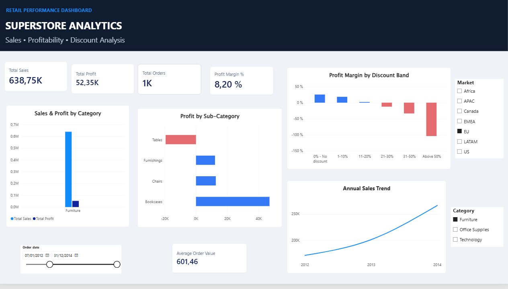

# Superstore Retail Analytics | PostgreSQL + Power BI

An end-to-end retail analytics portfolio project: **SQL data profiling, cleaning, validation and business analysis**, followed by an interactive **Power BI** report.

### 2. Dashboard with interactive filters

### 3. Profitability and discount analysis

## Business questions
- Which categories and sub-categories drive sales and profit?
- Which table products and markets generate losses?
- How does profitability change across discount bands?
- How have sales evolved from 2011 to 2014?

## Dataset and tools
- **Source:** Superstore Orders, imported into `public.raw_superstore_orders` (21 text fields)
- **Cleaned dataset:** `public.clean_superstore_orders` (typed fields plus `shipping_days`)
- **Validated row count:** 51,290 sales lines and 25,035 distinct orders (based on the author's PostgreSQL results)
- **Stack:** PostgreSQL 17, pgAdmin, SQL, Power BI Desktop, Power Query and DAX

## Dashboard metrics (no filters)
| Metric | Value displayed |
| --- | ---: |
| Total Sales | 12.64M |
| Total Profit | 1.47M |
| Total Orders | 25K |
| Profit Margin | 11.62% |
| Average Order Value | 505.01 |

The report includes sales and profit by category, profit by sub-category, profit margin by discount band, annual sales trend, and market/category/date slicers. Values are rounded by the dashboard; no currency symbol is asserted because the source currency has not been verified.

## Key observations
- **Tables** have negative overall profit in the sub-category analysis.
- Higher discount bands are associated with substantially lower, often negative profit margins. This is a descriptive association, not proof of causation.
- The dashboard supports interactive segmentation by market, category and order date.

## SQL workflow
1. [`01_create_raw_table.sql`](sql/01_create_raw_table.sql): create the raw text schema. Import the source CSV into this table before continuing.
2. [`02_data_quality_checks.sql`](sql/02_data_quality_checks.sql): missing values, duplicates, numeric formats, dates, discount ranges, shipping consistency and profit precision.
3. [`03_create_clean_table.sql`](sql/03_create_clean_table.sql): **final corrected** transformation, type conversion, `shipping_days` and validation.
4. [`04_business_analysis.sql`](sql/04_business_analysis.sql): category and sub-category performance, tables, market losses, product losses, discount bands and profitability segments.

### Important cleaning history
The first cleaning attempt stored `profit` as `NUMERIC(14,3)`, which lost decimal precision. The author subsequently rebuilt the table using **`NUMERIC(18,5)`**, preserving up to five decimals. The reproducible SQL includes the **final corrected version**, not the obsolete build. The final script drops and replaces the existing clean table: use only in a disposable/local environment after reviewing dependencies.

The supplied queries were deduplicated and minor pasted syntax issues fixed. Date parsing assumes **day/month/year** for both slash and dash formats, as in the author's actual scripts. Verify this assumption if applying the pipeline to another dataset.

## Reproducing the report
1. Create a PostgreSQL database and run `01_create_raw_table.sql`.
2. Import the original Superstore CSV into `public.raw_superstore_orders` with matching column order and CSV settings.
3. Run the data-quality queries, then the corrected clean-table script, then the business analyses.
4. Open the Power BI `.pbix` and update the local PostgreSQL data-source credentials/server to refresh it.

The source CSV, exported cleaned CSV and `.pbix` are **not yet included** in this starter archive. The user will add them locally. The repository's SQL and documentation do not require publishing personal information.

## Data privacy and licensing
Before committing any CSV, confirm redistribution rights and review personal fields (notably `customer_name`). If necessary, publish a privacy-safe sample or omit the CSV and provide reproduction instructions. Never commit passwords or database secrets.
